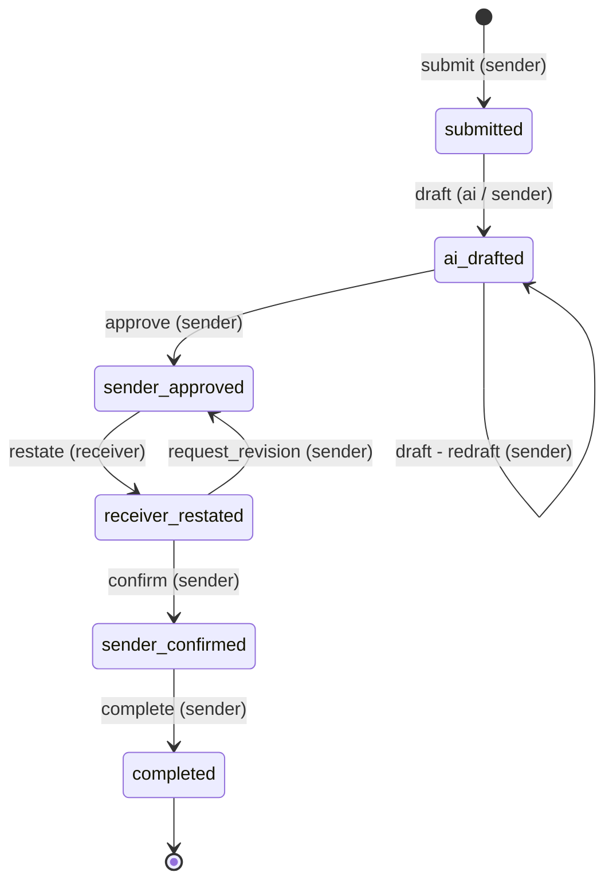

# Handoff state machine

Implemented in `app/state_machine.py` as a pure, table-driven module (no DB or HTTP).
Every transition is checked against two guards, in this order:

1. **Actor guard** - is this actor allowed to trigger the event at all? Failure is `403 forbidden_role`.
2. **State guard** - is the handoff in a state the event leaves from? Failure is `409 invalid_transition`.

Each applied transition is stored in the `transitions` table with event, from/to state, actor and UTC timestamp.

## States

| # | State | Meaning |
|---|-------|---------|
| 1 | `submitted` | Sender has submitted notes and links. No brief yet (or the AI draft failed). |
| 2 | `ai_drafted` | AI produced a structured brief. Sender may edit it or request a redraft. |
| 3 | `sender_approved` | Sender approved the brief. Receiver can now see it, ask questions, and restate. |
| 4 | `receiver_restated` | Receiver wrote a restatement. AI listed possible misunderstandings for the sender. |
| 5 | `sender_confirmed` | Sender confirmed the restatement is correct. |
| 6 | `completed` | Sender finalised the handoff. Terminal. |

## Actors

`sender`, `receiver` (both come from the client's `X-Role` header; no real auth) and `ai` (internal only,
can never be sent by a client: `X-Role: ai` is rejected with 400).

## Events

| Event | From | To | Allowed actors | Notes |
|-------|------|----|----------------|-------|
| `submit` | (none, creation) | `submitted` | sender | Creates the handoff. |
| `draft` | `submitted`, `ai_drafted` | `ai_drafted` | ai, sender | `ai` runs automatically on submit. `sender` re-triggers it (retry after AI failure, or redraft). Creates a new brief version. |
| `approve` | `ai_drafted` | `sender_approved` | sender | |
| `restate` | `sender_approved` | `receiver_restated` | receiver | Stores restatement, runs AI comparison. |
| `request_revision` | `receiver_restated` | `sender_approved` | sender | Sender found misunderstandings; comment required. Receiver restates again. |
| `confirm` | `receiver_restated` | `sender_confirmed` | sender | |
| `complete` | `sender_confirmed` | `completed` | sender | Only a sender can complete. The AI actor is rejected for every event except `draft`. |

Non-transition actions (no state change, same guards):

| Action | States | Actor |
|--------|--------|-------|
| `edit_brief` (new brief version) | `ai_drafted` | sender |
| `ask_question` | `sender_approved`, `receiver_restated` | receiver |
| `answer_question` | `sender_approved`, `receiver_restated` | sender |

Asking a question increments the handoff's `question_count` (evaluation metric).

## Diagram

## Evaluation data

- Every transition row has a timestamp, so time-to-understand = `restate` time minus `approve` time (latest pair),
  and total handoff time = `complete` minus `submit`.
- `question_count` is returned by the status and detail endpoints.
